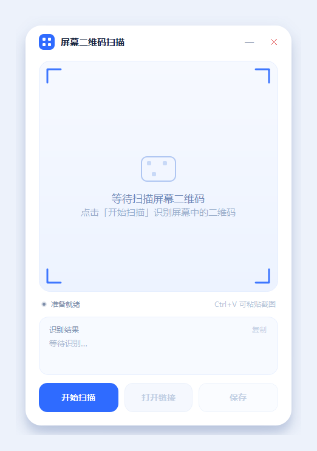
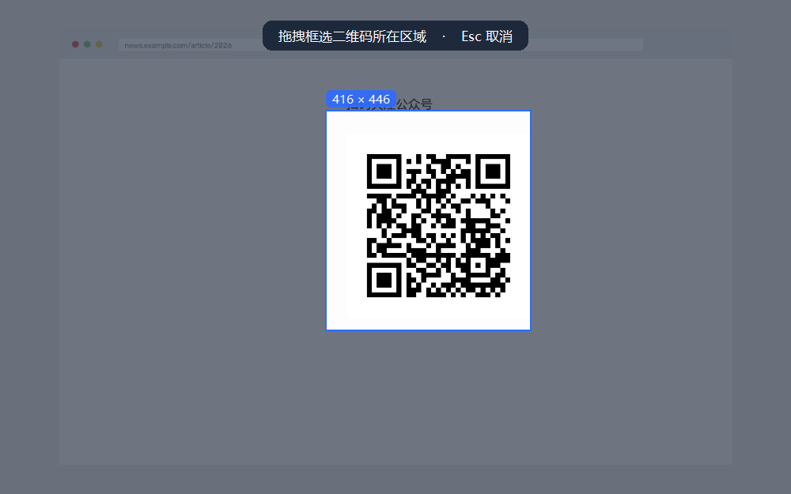

# 屏幕二维码扫描器 · Screen QR Scanner

> 专治「二维码在电脑屏幕上，手机扫不到、摄像头又对着屏幕反光」——直接截屏识别。
> A minimal desktop tool that scans QR codes **displayed on your screen**, no camera required.


## 为什么不做摄像头扫码

大多数扫码工具默认调用摄像头，但在电脑上最常见的场景其实是：二维码本身就显示在屏幕上——网页登录、微信公众号、文档里的链接、聊天窗口里的图片。这时举着手机拍屏幕，既要对焦又会反光，体验很差。

这个工具换了个思路：**把屏幕当作输入源**。隐藏窗口 → 截取屏幕 → 本地解码，一秒钟出结果，不调用摄像头、不上传任何图片。

## 功能

- **整屏自动识别**：点「开始扫描」即自动在全屏范围找二维码，无需手动框选
- **框选兜底**：整屏没找到时，弹出冻结屏幕的浮层，拖拽框住二维码即可（双击/回车可扫全屏，Esc 取消）
- **一键跳转**：识别结果是网址时，「打开链接」直接用默认浏览器打开
- **保存 / 复制**：结果可存为 txt，识别成功自动复制到剪贴板
- **粘贴识别**：`Ctrl+V` 直接识别剪贴板里的图片，遇到无法截屏的窗口也能用
- **纯本地运行**：解码全部在本机完成，不联网、不上传
- **界面**：无边框圆角窗口、白蓝配色、上下扫描线动画、扫描成功绿色取景框

## 界面

| 启动 | 扫描中 | 框选区域 |
| --- | --- | --- |
|  |  |  |

## 快速开始

### 方式一：直接下载可执行文件

到 [Releases](../../releases) 下载 `ScreenQRScanner.zip`，解压后双击 `屏幕二维码扫描器.exe`。
免安装、免 Python 环境。注意 `_internal` 文件夹要和 exe 放在一起。

### 方式二：从源码运行

```bash
git clone https://github.com/shentianyouren/screen-qr-scanner.git
cd screen-qr-scanner
pip install -r requirements.txt
python qr_scanner.py
```

需要 Python 3.9+（推荐 3.10~3.13）。

## 使用

1. 把二维码显示在屏幕上（网页、图片、聊天窗口都行）。
2. 点左下角 **开始扫描**，程序会先隐藏自己，然后截取屏幕并自动查找二维码。
3. 整屏没找到时会出现暗色浮层：拖拽框住二维码即可；也可双击浮层或按回车扫描整屏。
4. 识别成功后，扫描区显示截图与绿色取景框，内容自动复制到剪贴板。
5. 需要打开网页就点 **打开链接**，需要留存就点 **保存**。

| 快捷键 | 作用 |
| --- | --- |
| `Ctrl+V` | 识别剪贴板中的图片 |
| `Esc` | 框选浮层中取消 / 主窗口关闭 |
| `Enter` | 框选浮层中扫描整屏 |

## 打包为 exe

Windows 下双击 `scripts/build_exe.bat`，或在命令行执行：

```bash
pip install -r requirements.txt pyinstaller
pyinstaller --noconfirm --windowed --name ScreenQRScanner ^
  --icon assets/icon.ico --add-data "assets/icon.ico;assets" qr_scanner.py
```

产物在 `dist/ScreenQRScanner/`。仓库里的 GitHub Actions 也会在打 tag 时自动构建并上传 zip。

## 技术实现

- **截屏**：`QScreen.grabWindow(0)` 取整屏；先 `hide()` 自身再截，避免把自己的窗口截进去。多显示器时按虚拟桌面拼接。
- **解码**：`cv2.QRCodeDetector.detectAndDecode`，按 1.0 / 0.5 / 2.0 / 1.5 多尺度重试，兼顾大屏截图和小图标；返回的角点乘回缩放系数得到原图坐标。
- **DPI**：截图统一转成 1:1 设备像素（`QPixmap.fromImage(...toImage())`），后续裁剪、框选坐标都不用再换算，125% / 150% 缩放下也不会错位。
- **界面自绘**：`ScanView` 用 `QPainterPath` 做圆角裁剪、`contain/cover` 自适应、取景角标；扫描线拖尾是缓存好的渐变贴图（`CompositionMode_DestinationIn` 做左右柔化），每帧只画一次。

## 项目结构

```
screen-qr-scanner/
├── qr_scanner.py            # 主程序（单文件，约 900 行）
├── requirements.txt
├── assets/                  # 图标与界面截图
├── scripts/
│   ├── build_exe.bat        # 一键打包
│   └── make_icon.py         # 生成多尺寸 ico
└── .github/workflows/       # 打 tag 自动构建
```

## 常见问题

**Q：截图是黑的 / 识别不到？**
少数播放器、远程桌面、DRM 保护窗口不允许被截屏。可以改用 `Ctrl+V` 粘贴截图识别。

**Q：二维码在另一个显示器上？**
整屏扫描会覆盖所有屏幕，框选也支持跨屏拖拽。

**Q：识别率不高？**
二维码在屏幕上显示得越大越稳，边长建议 ≥ 200 像素，避免缩放模糊和强反光。

**Q：支持条形码吗？**
目前只做二维码。需要的话可以基于 `cv2.barcode.BarcodeDetector` 扩展。

## 贡献

Issue / PR 都欢迎。提交前建议跑一下 `python qr_scanner.py` 自测基本流程。

## 许可证

[MIT](LICENSE)
